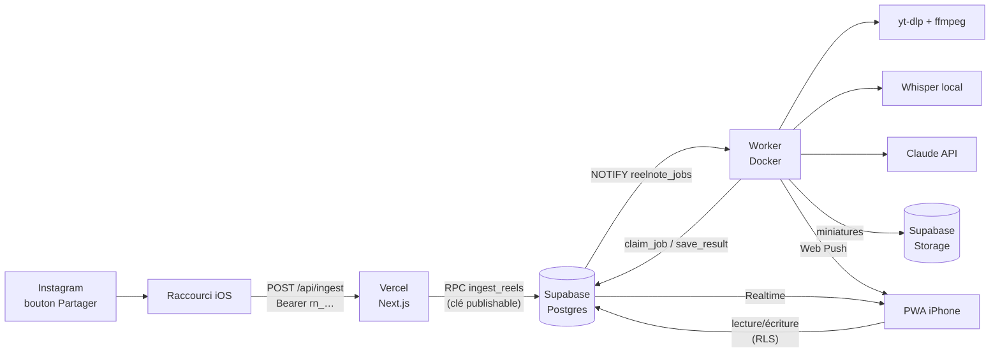
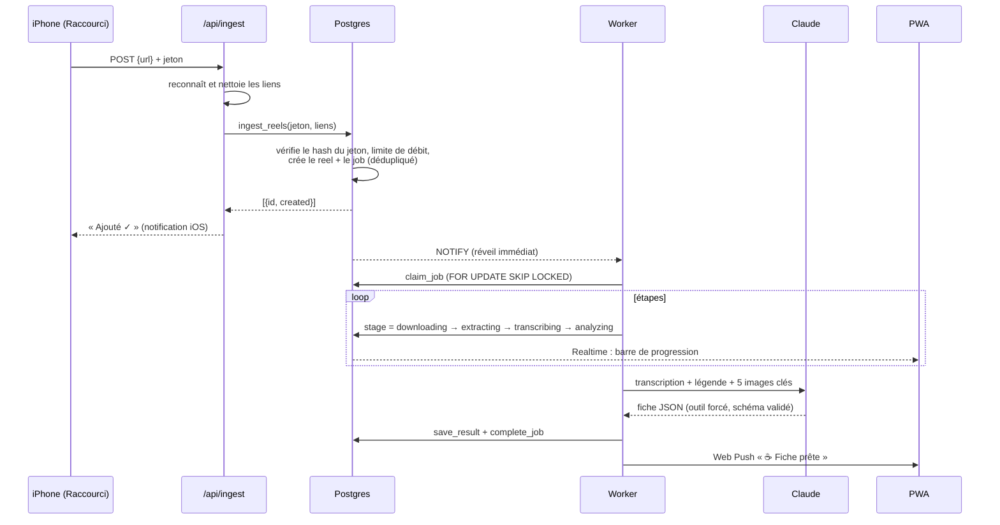

# Architecture

## Vue d'ensemble



Quatre briques, chacune avec un rôle unique :

| Brique | Hébergement | Rôle | Secrets détenus |
|---|---|---|---|
| **Raccourci iOS** | iPhone | Envoie le lien partagé | Un jeton d'ingestion révocable |
| **Web app** (Next.js) | Vercel, gratuit | Interface PWA + point d'entrée `/api/ingest` | Aucun |
| **Supabase** | Supabase, gratuit | Postgres, Auth, Storage, Realtime | (le coffre) |
| **Worker** (Python) | Ton PC ou un VPS | Télécharge, transcrit, analyse, notifie | Base de données, Storage, Claude, VAPID |

## Le parcours d'un reel



Durée typique : 20 à 60 secondes, dont l'essentiel en transcription sur CPU.

## Décisions d'architecture

Chaque choix est réversible et documenté ici pour qu'on sache *pourquoi* le jour où on voudra le changer.

### 1. PWA plutôt qu'application native
Pas de Mac ni de compte Apple Developer (99 €/an). Une PWA installée sur l'écran d'accueil s'ouvre en plein écran, reçoit des notifications push (iOS 16.4+) et se met à jour sans App Store. **Ce qu'on perd** : widgets natifs, Spotlight, extension de partage. **Compensation** : le Raccourci iOS remplace l'extension de partage, et un widget reste possible via l'app gratuite Scriptable (voir la feuille de route).

### 2. Raccourci iOS + jeton personnel pour l'ingestion
Un Raccourci ne sait pas gérer une session OAuth. On utilise donc un **jeton d'ingestion** dédié : 256 bits d'aléa, préfixe `rn_`, **seul son hash SHA-256 est stocké**, il est révocable et ne permet *que* d'ajouter des reels (pas de lecture). Un jeton par appareil.

### 3. Aucun secret côté Vercel
`/api/ingest` reconnaît les liens puis appelle une fonction SQL `SECURITY DEFINER` avec la clé *publishable*. C'est la base qui vérifie le jeton, applique la limite de débit et reconstruit elle-même l'URL canonique à partir de `(plateforme, identifiant)` : une URL fournie par le client n'est jamais téléchargée telle quelle. Si Vercel était compromis, aucun secret ne fuirait.

### 4. Postgres comme file de jobs (pas de Redis)
`internal.jobs` + `FOR UPDATE SKIP LOCKED` + `LISTEN/NOTIFY`. Zéro infrastructure en plus, transactionnel avec les données, et largement suffisant jusqu'à des milliers de jobs par heure. Toute la logique (réclamation atomique, backoff exponentiel, récupération des jobs bloqués) est en SQL, donc testée en CI. Un index unique partiel garantit qu'un reel n'est jamais traité deux fois en parallèle.

### 5. Le worker va chercher le travail (modèle *pull*)
Le worker n'a **aucun port ouvert** : il se connecte à la base, écoute les notifications et réclame les jobs. Il peut donc tourner derrière une box internet, sur un vieux PC, sans configuration réseau. Pour aller plus vite : `docker compose up --scale worker=3`.

### 6. Architecture hexagonale dans le worker
Le pipeline ne dépend que d'interfaces (`ports.py`). yt-dlp, ffmpeg, Whisper, Claude, Supabase sont des *adaptateurs* interchangeables. Conséquences : toute la logique est testée sans réseau, et remplacer un fournisseur (transcription via API, autre stockage) ne touche qu'un fichier.

### 7. Sortie structurée garantie
Claude est forcé d'appeler l'outil `save_reel_card` dont le schéma JSON est généré depuis les modèles Pydantic. La réponse est validée ; si elle est invalide, l'erreur est renvoyée au modèle **une fois** pour correction. Les champs trop longs sont tronqués plutôt que rejetés.

### 8. Fiches typées par contenu
Une partie commune (titre, résumé, points clés, action, tags, avertissement) et une partie `details` qui dépend du type : recette, sport, lieu, à voir/à lire, produit, astuce, apprendre, autre. C'est ce qui rend la fiche *actionnable* plutôt qu'un simple résumé.

### 9. Prompt versionné
Chaque fiche enregistre `analysis_version` et `analysis_model`. Quand le prompt s'améliore, on régénère de façon ciblée : `select internal.requeue_reel(id) from public.reels where analysis_version <> '…'`.

### 10. Transcription locale et gratuite
faster-whisper (modèle `small`, int8, CPU) suffit pour des vidéos de moins de 3 minutes. Le filtre VAD ignore la musique, ce qui évite les transcriptions inventées. Remplaçable par une API si le CPU manque.

### 11. Aucune vidéo conservée
Tout se passe dans un dossier temporaire supprimé à la fin du job. On garde la miniature (≈ 20 Ko en WebP), la transcription et la fiche. Économie de stockage, et moins de questions de droits.

### 12. Connexion par code e-mail, pas par lien magique
Sur iPhone, l'app installée ne partage pas sa session avec Safari : un lien magique connecterait Safari, pas l'app. On saisit donc un code à 6 chiffres reçu par e-mail.

## Sécurité

| Menace | Protection |
|---|---|
| Lecture des fiches d'un autre utilisateur | RLS sur toutes les tables, testée en CI (`supabase/tests`) |
| Modification de champs gérés par le worker | Privilèges **par colonne** : l'utilisateur ne peut modifier que `user_status`, `is_favorite`, `note`, `tags` |
| Fuite d'un jeton d'ingestion | Hash seul en base, révocable, ne donne aucun droit de lecture, limite de 60 reels/heure |
| Explosion des coûts IA | Limite de débit en base + plafond de dépenses dans la console Anthropic |
| Téléchargement d'URL arbitraires (SSRF) | URL canonique reconstruite côté serveur, liste blanche de plateformes, identifiants validés par regex |
| Injection de prompt via la légende ou l'audio | Contenus délimités et échappés, consigne explicite de les traiter comme des données, sortie contrainte par un schéma |
| Injection SQL | Requêtes paramétrées ; `LiteralString` impose des requêtes littérales dans le worker |
| Accès aux tables techniques | Schéma `internal` non exposé par l'API, privilèges révoqués |
| Fonctions `SECURITY DEFINER` détournées | `search_path` vide, noms entièrement qualifiés, droits d'exécution accordés un par un |
| Inscription d'inconnus | Inscriptions désactivées dans Supabase après la création de ton compte |
| Conteneur compromis | Utilisateur non root, système de fichiers en lecture seule, `cap_drop: ALL`, `no-new-privileges` |
| Clickjacking, sniffing | En-têtes `frame-ancestors 'none'`, `nosniff`, `Referrer-Policy`, HSTS |
| Redirection via une notification | Le service worker n'ouvre que des pages de l'app elle-même |

## Modèle de données

```
auth.users ─┬─< public.reels ──< internal.jobs
            ├─< public.ingest_tokens
            └─< public.push_subscriptions

internal.storage_garbage   (miniatures à supprimer après effacement d'une fiche)
```

- **`reels`** : la source (`platform`, `external_id`), l'état technique (`status`, `stage`, `error_*`), le contenu extrait (`caption`, `transcript`), la fiche (`kind`, `title`, `tldr`, `key_points`, `tags`, `card` en JSONB), la couche utilisateur (`user_status`, `is_favorite`, `note`) et l'index de recherche `search` (français, sans accents, pondéré).
- **`ingest_tokens`** : hash, préfixe affichable, dernière utilisation, révocation.
- **`push_subscriptions`** : un abonnement Web Push par appareil ; les abonnements expirés sont supprimés automatiquement.
- **`internal.jobs`** : statut, tentatives, `run_after` (backoff), verrou (`locked_by`, `locked_at`).

## Passage à l'échelle

L'app est multi-utilisateur dès le départ (`user_id` partout, RLS). Ordres de grandeur :

| Charge | Ce qui tient | Quand changer |
|---|---|---|
| 1 à 50 reels/jour | 1 worker sur un PC | — |
| Quelques centaines/jour | 2 à 3 workers sur un VPS 4 vCPU | Transcription trop lente → modèle `base` ou API de transcription |
| Milliers/jour | N workers, Supabase payant | File Postgres toujours suffisante ; ajouter une priorité par job |
| Base volumineuse | Index GIN déjà en place | Pagination par curseur déjà en place dans l'app |

## Coûts

| Poste | Coût |
|---|---|
| Vercel (offre Hobby) | 0 € |
| Supabase (offre gratuite) | 0 € |
| Worker sur ton PC | 0 € (électricité) |
| Worker sur un VPS (optionnel) | ≈ 4 à 5 €/mois |
| Transcription (Whisper local) | 0 € |
| Analyse Claude Haiku | ≈ 1 centime ou moins par reel (5 images + texte) |

Ces montants sont des ordres de grandeur : les offres gratuites et les tarifs évoluent, vérifie-les au moment de t'inscrire. Le nombre de tokens consommés par fiche est enregistré (`input_tokens`, `output_tokens`), ce qui permettra d'afficher le coût réel dans l'app.

## Limites connues

- **yt-dlp et Instagram** : télécharger depuis Instagram est une zone grise vis-à-vis de ses conditions d'utilisation, et ça peut casser quand Instagram change. C'est pour ça que le téléchargement est isolé derrière une interface, et que l'image Docker se reconstruit facilement pour suivre les mises à jour de yt-dlp.
- **Offre gratuite Supabase** : un projet inactif pendant une longue période peut être mis en pause ; il se réactive en un clic depuis le tableau de bord.
- **Notifications sur iPhone** : uniquement quand la PWA est installée sur l'écran d'accueil.
